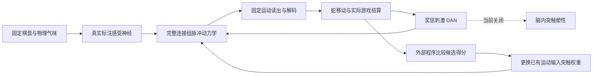

# 果蝇脑贪吃蛇：总体架构与学习机制审计

审计日期：2026-10-02。结论依据当前源码、已提交实验记录、实际 Windows 进程和原始研究论文。本轮没有重启训练、修改神经模型、修改历史记忆或生成新学习成绩。

**判断：继续沿用当前方案扩大训练量，没有充分依据。应该保留连接组、环境和存档，把学习机制与验证流程重新拆开。** 多次实验改变了权重、增加了活动，但没有证明可靠的状态相关学习。此前过多时间花在搜索参数和实现恢复上，缺少对学习因果链的逐段验证，这是项目方向上的问题。

这不证明连接组模型不能学习，也不说明已经得到一个天然果蝇大脑。当前模型是在实测连接拓扑上运行的、含多项工程假设的神经模拟器。

## 1. 当前真实运行到了哪里

- 审计时未发现本项目的实际 Python 训练或观察服务进程，8773/8774 没有监听服务。
- 化学通路实验保存了 **14/16 轮**，第15轮未提交；状态文件仍为 `running`，最后更新时间为9月30日13:26。该字段已经过期，不能证明后台在运行。进程退出原因未由现有日志确定。
- 第14轮存档存在且文件哈希通过核验。正常参数为 `[1,0,-2,-1]`，冻结为 `[0,0,0,0]`，错配为 `[-3,0,1,0]`。这些是静态权重搜索坐标，不是“学会”的分数。
- 化学实验还没有最终三组冻结评估，不能补报学习改善。
- 本轮完成了此前尚未核对的协调器恢复比较：从第3轮非零正常参数恢复，重做第4轮的 **81个实际原生试次**，与连续运行的脉冲、动作、反馈、候选筛选、提交参数及RNG一致。这证明恢复正确，不证明学习正确。
- 新普通贪吃蛇程序的权重被明确冻结，属于连续观察/评估程序；源码存在不能说明它会继续在线学习，也没有本轮原生运行证据。

可复现证据：[结构化审计](diagnostics/architecture-audit-2026-10-02.json)、[协调器恢复比较](diagnostics/chemical-coordinator-resume-20260930-v1/result.json)。运行审计：

```powershell
.\.venv\Scripts\python.exe scripts/audit_learning_architecture.py --output diagnostics/architecture-audit-2026-10-02.json
```

审计程序只读已提交记录和源码，不加载神经模型、不产生动作、不修改实验目录。

## 2. 目前的架构实际是什么

完整模型有166,700个节点、25,582,938条聚合边；连接组没有被缩成一个外部策略网络。固定棋盘RGB刺激真实标注的感光细胞；环境计算双侧虚拟气味，刺激实际 ORN_DM1。完整脉冲动力学产生 DNa02 左右读出，固定解码器把它们转换成蛇的相对转向。



最近几版不是“DAN奖惩直接训练脑内记忆”的系统，而是“固定脑内可塑规则，外部程序按游戏回报优化已有突触”的系统。外部优化本身可以是合法的模型训练方法；因为它不直接输出动作，也不等于偷偷加了寻路器。但它必须有可控的参数、有效的目标和泛化证据，不能据此宣称复原了天然学习机制。

## 3. 已确认的主要问题

### A. 奖惩刺激与持续记忆更新脱开

`LabBrain` 初始化和重置均设置 `weights_frozen=True`，积分调用 `learning=False`。`NativeSensoryBasisBrain.observe/feedback` 也传入 `learning=False`，后续 actor、pulse、chemical 类继承这条路径。

化学实验14个已提交轮次中，共记录 **981次反馈：奖励382次、惩罚599次**。

| 检查 | 结果 |
|---|---:|
| DAN实际刺激发放数 | 每次76至448个脉冲 |
| 反馈调用启用学习 | 0次 |
| 反馈调用改变局部候选效力 | 0条 |
| 反馈前后局部记忆哈希不同 | 0次 |

哈希范围需要说清：反馈收据中的哈希是继承的 `LabBrain.fraction`，不是整脑全部权重；外层 `NativeSensoryBasisBrain.feedback` 另行核对当前被搜索的权重哈希不变。源码还明确冻结了原 KC→MBON 记忆路径。以上共同支持“反馈期间没有持续突触学习”的结论，不能只拿一个局部哈希推断整脑。

后续权重变化由 `accept_game_candidate` 在试次之后选择当前/正/反候选产生。DAN被刺激到，与某条突触获得正确的信用，是不同的事情。现在增加刺激强度也不能修复关闭的更新路径；记录中的调制量本来已接近饱和的±1，而外部搜索直接使用标量游戏回报。

定位：`flysnake/lab/brain.py:20`、`:45`、`:67`、`:100`；`flysnake/research/sensory_basis.py:139`、`:148`；`scripts/train_chemical_controls.py:86`。

### B. 动作解码混合了两套不同标准

左右 DNa02 的中性校准不同：基线约15/4.58Hz，尺度约11.55/3.70Hz。当前先按原始脉冲差判断是否直行，其余窗口又回到各自标准化后的差值。因此“原始左脉冲更多”不一定解码成左。

981个已提交决策中，**74个转向窗口**的最终方向与原始脉冲较强的一侧相反。例如左8、右5却右转。这包含重复的冻结候选，不能算74个独立世界或74次独立故障。它是固定变换的结果，不是随机动作兜底，也不能解释成神经元主动学会反向转弯。

另外，命名为 `forward` 的 DNp20 两个细胞，并不独立决定前进：`decode` 真正的方向分支只看左右差值，额外细胞主要参与全静默检查和展示。应在新协议中准确描述为“转向平衡时前进”，不要把它展示为已验证的三动作神经竞争。

DNa02差值与真实果蝇转向有关，具有文献依据；把它离散成90度蛇转向、选定阈值和游戏步长仍是工程接口。[DNa02原始研究](https://pmc.ncbi.nlm.nih.gov/articles/PMC12279373/)。

修复原则：在新协议中采用一套一致、冻结的读出；原始左右差接近就前进，较大差值方向保持单调，不再用两侧不同的尺度翻转符号。可以用无奖励实验检查工作点，但不能拿测试得分反复调解码再算成学习。旧协议和旧成绩保留。

定位：`flysnake/lab/protocol.py:52`、`:57`；`flysnake/research/pulse_balance.py:18`；`flysnake/research/paired.py:101`。

### C. 能刺激到神经元，还不等于有可学习的任务表示

静态采样覆盖、画面看起来清楚、全脑脉冲不同、候选权重能改变方向，分别只证明有限的可见性或敏感性。它们没有证明运动通路能联合表示食物、蛇头朝向和障碍。

当前整棋盘相机不跟随蛇头，这满足用户要求；但这是第三人称棋盘任务。大脑需要从符号图像中关联“棋盘头位置和朝向”与“当前身体相对动作”，天然连接组没有自动预装这个游戏规则。虚拟双侧气味降低了空间任务难度，但同一 ORN_DM1 通道的浓度变化与自然多气味身份编码也不是一回事。

化学候选只搜索四个按浓度响应构造的静态权重轴，没有证明这些轴足以表达避障和随姿态变化的策略。完整脑仍可处理视觉，因此不能断言它数学上只能产生转向偏置；可以确认的是，这个表达能力尚未被验证。

当前固定背景电流影响41,928个中央细胞，运动细胞另外接受12mV等效电流。这样能唤醒通路，也可能改变左右竞争、稀疏编码和网络工作点。它是待校准的模型假设，不能把“更多神经元活跃”当成任务表示变好。

修复原则：在奖励实验之前，固定身体姿态只变食物，固定食物只变身体朝向/障碍，检查真实受体、候选塑性位置、MBON和运动通路各自是否保留所需差异。离线诊断器可以测信息，绝不能用它控制蛇；使用按姿态隔离的新场景，不能把相关图片视为独立样本。

### D. 早期资格迹不是已验证的信用分配

actor版本用突触前计数偏差、已有权重及人工软概率斜率，近似产生每条运动输入的资格迹。真实策略却由有反馈、阈值和延迟的循环脉冲网络及硬解码器决定；软概率没有参与动作采样，其斜率不是实际行为概率的梯度。

已有小规模因果探针出现反向响应，最终 actor 对照也没有改善。这足以否定“该资格迹已经可靠”这一说法，但探针太少，不能据此估计整个网络的梯度准确率。

新化学版本绕开了这个近似梯度，却也绕开了在线信用机制。它不能证明之前的信用分配已经修复。

调权还同时改变一个按旧32帧无奖励平均计数计算的补偿电流，限制在±3mV。候选的实际干预因此是“权重加电流补偿”，不能把行为变化全部归因于突触本身。化学20条件基底与该旧均值来自不同刺激分布，应分别做消融，而不是静默继承。

定位：`flysnake/research/actor_credit.py:61`、`:68`、`:152`。

### E. 局部批次改进无法保证累积进步

化学实验每轮随机取每个朝向一个身体姿态，约5至9个世界；当前/正/反都真实试玩，但接受条件只要求在这一批严格改进。没有检查以前已学世界是否退步，也没有累计目标。

“同姿态穷举合法食物”仍不等于三动作平衡。例如第6轮有右3、左2、前0个目标；第14轮才是3/3/3。全局转向偏置可能提高某一批成绩，却破坏其他姿态。

错配组把三个候选回报循环移位，确实不是恒等索引；但这测试的是“候选评价对应是否正确”，并没有测试DAN对特定线索的生物关联。它可能选择差候选，因此要结合冻结、简单恒定动作基线和独立种子，不能把只胜错配当成有效学习。

修复原则：若保留外部搜索作为工程对照，使用固定且平衡的训练世界集合及累计回放目标，比较新旧参数在同一个训练目标上的净变化。仍须保留独立评估；不得使用正确动作、距离或路径来生成脑动作。这只是搜索方法修复，不能代替脑内塑性证明。

### F. 单步课程与普通贪吃蛇之间缺少经过验证的过渡

当前 `adjacent_one_step` 每个世界只运行一个决策，之后完整重置短时神经状态。没吃到额外惩罚−1，即便这一步没有死亡。它可以用于短期诊断，却不等于用户要求的普通游戏。

一次真实吃食/死亡的刺激之后，下一世界会清空短时状态；当前只有外部提交的参数保留。普通游戏需要处理过去动作、持续神经状态和延迟奖励，不能靠把单步的训练次数加起来得到。

新普通程序明确冻结权重，更不能通过一直运行它来期待新学习。需要单独实现并验证同一局内持续的资格迹和塑性，而不是只保留棋盘状态。

定位：`scripts/train_actor_credit.py:70`、`:89`、`:99`；`scripts/run_ordinary_chemical_snake.py:1`、`:109`。

### G. 工程验收与学习验收混淆

存档哈希、原生重放、游戏碰撞规则、网页运行、源码测试都很重要。但它们回答“实现是否一致”，不是“奖惩是否使行为更好”。

多个新协议反复用同一个16场景基线和类似预留姿态作开发比较。即便每次训练像素与预留像素不重合，预留表现已经被开发者用于改方案，它也属于开发验证集，不能再称为最终从未使用的独立测试集。

应分别报告：神经模拟速度/状态、权重变化、学习效果、保存恢复。页面的时间戳和状态文件也必须与真实进程心跳分开。

## 4. 实验给出的结论

| 完成的4×4单步实验 | 初始 | 正常 | 冻结 | 错配 | 结论 |
|---|---:|---:|---:|---:|---|
| 静态SVD八轮 | 7/16 | 7/16 | 7/16 | 7/16 | 无改善 |
| 自选动作资格迹八轮 | 7/16 | 7/16 | 7/16 | 7/16 | 参数变化无净改善 |
| 原始脉冲平衡门八轮 | 7/16 | 8/16 | 7/16 | 9/16 | 正常低于错配；不能证明学习 |
| 化学四轴 | 7/16 | 未评估 | 未评估 | 未评估 | 14轮存档，不作最终结论 |

前三轮评估目标分布为左7、前3、右6，因此“永远左转”就能拿7/16；这个标签只用于离线审计，没有送给脑。原资格迹正常组最终14/16窗口左转却仍7/16，说明改变动作分布可以掩盖没有增加有效策略。

脉冲平衡版正常对冻结的配对吃食均差为+0.0625，按身体姿态聚类的95%区间为[-0.375,0.5]；对错配为−0.0625，区间[-0.3571,0.2857]。样本小且区间跨零，既不能宣称学习，也不能据此宣称任何可能改进都不存在。

更早的 v4 两选一线索学习同样没有通过：首次正常24/32，但反转后正常、冻结、错配均16/32。旧局部规则100局的近食物成绩有所提高，普通随机食物仍0→0。这些不支持泛化的贪吃蛇学习。

## 5. 学习机制应怎样理解

连接组提供“谁连接谁、多少接触、哪些细胞”，不提供完整的膜参数、受体、神经调质扩散、突触效力、身体传感和记忆规则。连接拓扑参与运行，不会自动补齐这些机制。

Shiu等的全脑LIF研究主要检验感官到运动的响应预测，明确讨论了忽略神经形态、受体动力学、神经调质及内部状态等限制，不能把其成功解释为自动获得通用学习。[原始论文](https://www.nature.com/articles/s41586-024-07763-9)。

果蝇关联记忆的强证据集中在特定蘑菇体分区：线索激活的KC与相应DAN在合适的时间配对，改变已有KC→MBON突触；随后同一线索产生改变后的MBON输出。改变必须具有线索选择性、时序依赖和分区依据，而不是只证明DAN发放了。[Hige等](https://pmc.ncbi.nlm.nih.gov/articles/PMC4674068/)。

奖励也不等于“所有通路都加强”，惩罚也不等于“所有通路都减弱”。KC→MBON塑性的方向取决于分区、时序和受体/第二信使路径；2024年的实验还区分了cAMP相关抑制与cGMP相关增强。[Yamada等](https://pmc.ncbi.nlm.nih.gov/articles/PMC11068490/)。

项目保留的 `rule.py` 参考Huang等的九单元模型，但那篇模型的分区、权重及参数通过生理数据拟合。我们把一种中心化率规则应用于男性连接组的PAM11→α1/MBON07与PPL101→γ1pedc/MBON11、使用接触比例代替调制增益，没有复现原论文的完整参数校准；把同一规则直接用于两个分区仍是假设。[Huang等原始研究](https://www.nature.com/articles/s41586-024-07819-w)。所以简单解除 `weights_frozen` 也不足以修复整个设计。

反过来，用工程优化学习连接组参数也是可行研究方向，但成功实例需要明确任务目标、训练算法和独立神经验证。Lappalainen等的视觉模型采用任务优化及时间反向传播，并包含任务读出；不能原封不动引入本项目来绕过“果蝇脑实际运动输出控制蛇”的约束。[原始研究](https://pmc.ncbi.nlm.nih.gov/articles/PMC11525180/)。

奖励预测误差或基线可提高信用分配稳定性，但不是任何简单关联学习必须先具备的万能开关。相关计算模型也明确区分了线索学习与跨时间信用分配。[Bennett等](https://www.nature.com/articles/s41467-021-22592-4)。

可检验的因果链应是：

**线索能区分 → 相应突触有活动资格 → 奖惩在正确时间调制这些突触 → 同一线索改变运动通路输出 → 改善保留并迁移到新场景。**

当前已经验证部分感官可达性、部分权重敏感性和恢复一致性；没有验证这条链的完整成立。

## 6. 建议的修复顺序与停止条件

这次不再同时换视觉、运动细胞、刺激强度、参数搜索和奖励规则。先建立可以定位失败环节的机制实验，再回到游戏。以下是下一阶段设计，不是已完成的实现或成功成绩。

| 次序 | 要解决的问题 | 实验与通过证据 | 未通过时处理 |
|---|---|---|---|
| 1. 锁定基线 | 感觉与动作接口是否一致 | 固定相机；无奖励校准；原始DNa02差值单调读出；镜像/单侧干预；报告左右工作点、静默率、固定转向基线 | 修感觉或读出，不训练 |
| 2. 验证可塑位置 | 真实线索能否到达有依据的记忆突触 | 核对具体KC/DAN/MBON分区；测两组受体刺激在KC及MBON的真实脉冲；小幅已有突触干预是否影响下游DNa02 | 修模型工作点或选择证据支持的分区，不扩大搜索 |
| 3. 验证最小记忆 | 奖惩是否造成线索特异、持续的变化 | 两种物理线索配对/不配对，冻结、错时、反转、权重回滚；只在相应已有KC→MBON连接执行显式塑性，检查实际ΔW、MBON选择性及运动输出 | 定位时序、资格迹、符号或下游传递；不进入Snake |
| 4. 验证单步操作学习 | 记忆能否帮助相对转向 | 固定棋盘、头朝向可见；平衡左/前/右；训练和评估姿态隔离；动作只能来自神经脉冲；胜冻结和错配并完成反转 | 检查状态表示与行为信用，不用外部诊断器代选 |
| 5. 验证普通游戏 | 延迟奖励、连续状态和身体增长 | 同一局保持神经状态和资格迹；实际吃食奖励、撞墙撞身惩罚、无输出惩罚后继续；从短轨迹到随机食物，再到12×12 | 报告哪个阶段未迁移，不以近食物成绩替代 |
| 6. 正式验收 | 改善是否可靠、可保存 | 至少3个独立训练种子；参数冻结、关闭探索的新评估；训练后正常优于自身训练前及冻结/错配；报告区间、失败种子和断点恢复 | 不宣称完成目标 |

第3步与过去已失败的两选一试验不同：过去主要在运动输入上用工程竞争/扰动规则直接寻找动作；这一步先验证有分区依据的脑内记忆及其因果传递，必须能定位“未形成记忆”还是“有记忆但传不到运动”。不只是换名字再运行同一个门。

新塑性机制应在神经模拟器内部计算，输入只含真实突触活动、时序及神经调制；不给正确方向、蛇坐标、危险掩码或目标路径。保留完整连接组和原有连接符号，不增加外部策略网络。具体分区规则与参数要根据文献及实际原生脉冲校准，不能把上述设计写成已复原的天然生理。

先做关联记忆是缩小诊断范围，不意味着把贪吃蛇目标改成两选一小游戏。关联记忆成功也不能保证完整Snake会成功；它只是避免在一个没有验证过学习机制的系统上继续投入长训练。

## 7. 本轮已经处理与尚未处理

已经完成：总体源码审计；四个协议的已提交成绩核对；981次奖惩的实际路径统计；74个读出反向窗口统计；当前进程核实；四个协议最新存档的文件哈希核验；81试次完整协调器恢复比较；原始论文机制核对；可复现的只读审计工具和本报告。另独立重算981份已记录脉冲的解码，均与收据一致；四个协议的来源哈希与当前源码一致；13项读出、候选搜索及提交规则相关回归通过。这些核对没有执行新的神经训练，也不作为学习成功证据。

尚未完成：新的脑内塑性规则及原生验证；一致读出的新训练协议；独立新测试集；普通贪吃蛇在线学习；12×12和三种子正式验收。不能把本轮审计当成这些问题已被代码解决。

旧运行目录与旧记忆保留，不把不同协议的回合数相加。下一步应先做第1至3步，只有机制证据成立才恢复大规模游戏训练。
