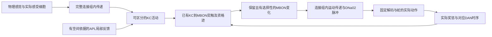

# 果蝇脑学习失败：细胞动力学与局部抑制复核

2026-10-02。接续 [总体架构审计](ARCHITECTURE_AUDIT_2026-10-02.md) 和 [原生记忆机制审计](NATIVE_MECHANISM_AUDIT_2026-10-02.md)。

**当前应修复并验证神经响应模型，再恢复游戏训练。** 已确认的失败链是：感觉刺激使网络进入持续活动；内源惩罚细胞在没有额外惩罚时也发放；当前只有减弱方向的记忆规则因此会污染多种线索。直接增强抑制虽然降低 KC 活动，却同时切断记忆输出。这解释了为什么更多回合、更多奖惩或全局参数搜索都缺少成功依据。

以下是冻结完整连接组的机制诊断。没有在这些实验中运行贪吃蛇、接受游戏得分或训练外部动作策略。连接图包含166,700个节点、25,582,938条聚合边。不能把生理候选、保存恢复或测试通过计作学会游戏。

## 1. 单次刺激结束后，活动并没有随外加输入消失

移除视网膜、lamina 和零气味背景电流，中央额外电流为0。每次先无气味300ms，再给予一种气味300ms，随后移除气味3000ms。同一试次内不重置短时神经状态，所有权重冻结。

| DNa02 外加电流 | 线索 | 移除刺激3秒后的最后500ms，gamma1 输入KC总脉冲 |
|---|---|---:|
| 12mV | DM1 | 4423 |
| 12mV | DM4 | 4668 |
| 0mV | DM1 | 4364 |
| 0mV | DM4 | 4259 |

0mV条件在该阶段逐窗口核对 **全体神经元的外加驱动均为0**；因此不能把这些残留活动解释为漏关的感觉电流或运动电流。原始无刺激基线中的该组KC与PPL101均不发放，但单次刺激之后PPL101仍有活动。

证据：[完整记录](runtime/native-clearance-20261002-v1/status.json) 与同目录原生计数数组。这说明该模型的循环活动持续存在，不证明任何生物脑都必须在3秒内归零。对当前“每个DAN事件都与非负KC迹相乘并减弱”的规则而言，这种活动会破坏配对的时间和线索选择性。

## 2. 降低活动，可能同时消除可以学习的通路

参数在模型加载前声明，未使用游戏回报筛选。所有条件保留连接端点及符号；局部干预只作用于已有连接。

| 干预 | 真实结果 | 判断 |
|---|---|---|
| 全部接触权重乘0.5 | KC仍响应且有残留活动；gamma1 MBON不发放 | 记忆通路不完整 |
| 全部接触权重乘0.25或0.125 | 残留活动消失，气味也不再到达gamma1 KC/MBON | 安静不等于可用 |
| 全局抑制权重乘2或4 | KC大幅减少；gamma1 MBON均不发放 | 不能靠这一调整开始训练 |
| 仅APL→KC抑制乘2、4或8 | KC减少，MBON仍不发放；gamma1突触减弱20%不能影响DNa02计数 | 可塑位置失去下游作用 |
| APL→KC乘2，额外给两个MBON3或5mV电流 | MBON仍不发放 | 背景电流未恢复传递 |

上表只描述已执行的具体条件，不估计所有可能参数。APL v1在读取错误的数据列时失败，没有产生原生观察；修复后的独立v2才作为证据，失败目录保留。

## 3. 实际膜电位揭示了抑制与兴奋失衡

逐10ms读取两个gamma1 MBON的实际膜电位、原模型的有符号突触状态g、外加驱动和脉冲。另统计实际突触前脉冲乘已有连接权重，作为潜在传递预算。

| DM1条件 | 两个MBON的线索期平均膜电位 | KC潜在正预算 | APL潜在负预算 |
|---|---|---:|---:|
| APL→KC原增益，无MBON额外电流 | −60.47、−55.42mV | 17055.50 | −9674.78 |
| APL→KC乘2，无MBON额外电流 | **−105.30、−122.22mV** | 1676.40 | −8657.55 |
| APL→KC乘2，MBON额外5mV | −100.30、−117.22mV | 1676.40 | −8657.55 |

实际驱动读数确认5mV电流已送达；不能归因于按钮或电流代码未生效。增强APL→KC后，KC对MBON的兴奋预算约下降一个数量级，而APL→MBON的直接负预算仍很强。原有符号电流模型没有抑制反转电位，强负输入可以持续把膜电位拉低。

预算并非实际接收的EPSC积分：它没有重建1.8ms延迟与不应期拒收，只能说明输入来源与量级。膜电位、g、驱动和计数则是实际原生积分器的边界状态与脉冲。证据：[膜电位诊断](runtime/native-mbon-state-20261002-v1/status.json)。

## 4. 原始生理研究支持哪些机制

**APL不能简单视为一个向整棵树广播脉冲的细胞。** 局部刺激及体积钙成像显示，成虫APL是非脉冲神经元，活动和对KC的抑制都有空间局部性。原模型把所有细胞，包括APL，都设为同类脉冲点神经元，这与该机制不一致。[Amin等，2020](https://pmc.ncbi.nlm.nih.gov/articles/PMC7541083/)。

**抑制受体有反转电位。** 培养蛹期神经元的电生理记录区分了烟碱乙酰胆碱受体和GABA受体电流，也测得不同的反转电位；这些实验不能直接给出本项目成虫男性MBON的参数。[Su与O'Dowd，2003](https://pmc.ncbi.nlm.nih.gov/articles/PMC6740836/)。因此本轮电导候选采用的0mV、−70mV明确是工程假设，不引用这篇论文作为其精确测量值。

**每接触0.275mV不是通用连接组常数。** 上游模型将这一自由参数校准到雌性FlyWire模型中糖受体100Hz刺激与MN9响应的特定关系。本项目把它用于男性全CNS、不同感官和记忆通路，尚没有独立验证这种转移。[Shiu等，2024](https://pmc.ncbi.nlm.nih.gov/articles/PMC11446845/)。这不否定原论文所验证的任务，说明本项目需要重新校准自己的动力学。

当前KC适应、分区调制增益、DAN背景、阈值及感觉电流同样不是由连接图直接给出的实测参数。

## 5. 独立电导诊断的范围

新增 `conductance_native.py` 和独立C++内核。保留全部节点、边端点、权重符号、0.1ms时间步、1.8ms传递延迟和固定原始DNa02读出；学习关闭，桥接器拒绝训练调用。原内核与旧存档依赖未修改。

膜方程为：

`20 dv/dt = rest − v + drive − adaptation + gE(EE − v) + gI(EI − v)`

已有正权重除以目标细胞的静息兴奋驱动力，负权重除以静息抑制驱动力，得到非负电导事件；这是静息输入尺度对应，不是生理拟合。不应期将膜电位钳在静息值，受体状态继续衰减并接收事件。原始模型会清零突触状态并在不应期拒收，两者明确不同；原始模型的实现与其上游参考一致，不能称为调度代码写错。

数值实现是冻结中点系数的指数步进。衰减本身解析，时变电导对膜电位的影响为二阶近似，不能称为完整精确解析解。小型数值测试核对了无输入闭式解、反转方向、独立高精度RK4、受体状态的不应期行为、跨调用延迟事件和训练拒绝；这些是实现检查，不是学习证据。

完整图诊断包括APL→KC原增益与乘2，两种气味，以及运动电流为0的对照。结果由同目录不可变数组和来源快照保存。**即使膜电位不再无界下移，只要感觉到KC/MBON的传递或记忆到DNa02的传递失败，该版本仍不可进入训练。** 目前它仍把APL当脉冲点细胞，没有完成局部非脉冲APL模型。

**该有限诊断已实际完成，三个配置均未通过。** 六个线索条件中的gamma1 KC与MBON脉冲均为0；部分条件撤除气味后PPL101仍有持续活动；gamma1权重减弱20%没有改变MBON或DNa02计数。受观察的MBON膜电位满足所设反转约束，但感觉到记忆通路的传递失败。因此该候选被保留为诊断证据，没有部署为训练模型。证据：[电导完整图记录](runtime/native-conductance-20261002-v1/status.json)。

## 6. 数据与下一步架构

已核对本地原始 `edges.feather` 只有 `body_pre/body_post/weight`；规范化边只有 `pre_index/post_index/synapse_count`。细胞注释中的 `somaLocation` 是胞体位置，不能代替APL树上的接触位置，不能据此伪造局部距离。

官方另提供逐接触点与ROI的 `syn-points`（约12.7GB）、逐伙伴坐标的 `syn-partners`（约6.8GB）以及每细胞SWC骨架；neuPrint可按细胞查询，但其官方客户端需要令牌。[MaleCNS官方数据说明](https://male-cns.janelia.org/download)。本轮未下载这两份大表或声称已获得APL局部接触数据。

下一步把模型验证分成四个明确的接口：



这是拟验证的机制链，尚未整体实现或通过；图中省略的其他脑区仍必须参与完整连接组积分。没有一条从食物坐标或诊断标签直接通向动作的路径。

1. **生理数据与响应模型**：逐接触空间位置、APL的非脉冲局部传播、突触受体响应和经独立刺激校准的工作点。先验证有刺激时能传递、撤刺激后能回到可解释的状态；不能只优化静默。
2. **区分线索的记忆机制**：在已有KC→MBON连接上验证配对、无惩罚、错时、冻结、反转和权重回滚；把内源DAN活动与额外奖惩分开，检查持续与线索选择性。
3. **记忆到运动的因果传递**：确认相应记忆的改变能通过完整图改变DNa02，而不是只改变一个展示计数或借外部函数选方向。
4. **游戏信用分配与泛化**：机制通过后再进入同局持续状态、延迟奖惩、随机食物、增长身体、12×12与至少三个独立训练种子；关闭探索与学习做独立冻结评估，比较训练前、冻结和错配。

前两级没有通过，不恢复批量Snake训练。这里的暂停实验选择不改变原始贪吃蛇目标，也不代表已证明目标能够实现。新版本与旧记忆必须保持协议隔离，禁止把不同实验的回合数累加成学习进度。

## 7. 可复现分析与验收边界

`scripts/summarize_native_dynamics.py` 只读完成的7个原生诊断，检查当前来源/保存来源/计数数组哈希，并从实际数组核对清除期KC和DAN总数、线索期MBON计数、膜电位记录。任何未完成的原生诊断使分析拒绝生成，不用残留`running`字段代替完成证据。

```powershell
.\.venv\Scripts\python.exe scripts/summarize_native_dynamics.py --output diagnostics/native-dynamics-audit-2026-10-02.json
```

完整项目回归已通过212项。尚未证明线索特异奖惩关联、普通贪吃蛇学习、12×12泛化或三种子正式验收。

结构化分析已实际运行：[7个完成诊断与13个校准配置的核对结果](diagnostics/native-dynamics-audit-2026-10-02.json)。没有任何校准配置通过全部机制检查。结束时已核对Windows实际进程，以上诊断均已退出；没有后台训练或网页服务。旧存档与锁定源码保留。
