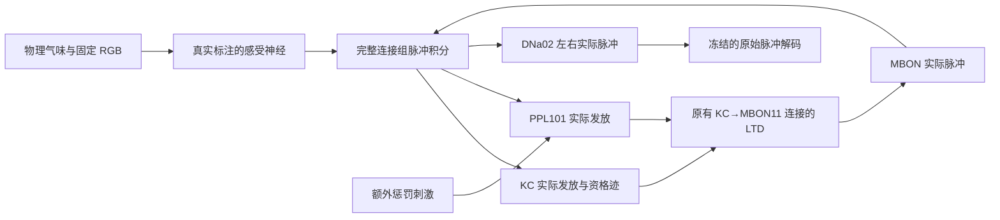

# 原生学习机制复核：已保存的变化为什么仍不是学习

2026-10-02。承接 [总体架构审计](ARCHITECTURE_AUDIT_2026-10-02.md)。本轮实际加载完整的 166,700 个神经元、25,582,938 条聚合连接，执行独立的新协议；历史训练代码、记忆和实验目录保留。

**结论：已经找到了可以复现的机制失败点。重新启用脑内突触更新后，气味本身就会诱发大量多巴胺脉冲，当前规则在额外惩罚开始前已减弱记忆连接；没有额外惩罚的对照也产生类似变化。现在不能把持续的突触变化、转向变化或更多训练回合称为关联学习。**

两个基础接口已经在新协议中修正并验证：统一使用原始左右运动脉冲解码；零气味时不再施加旧适配器的最低发放电流。其余发现仍是需要解决的模型问题。没有开始新的批量贪吃蛇训练。

## 1. 现在实际运行的机制



图中有一个重要问题：**气味通过脑内活动就能驱动 PPL101；它不需要等到实验者给出惩罚。** 当前模型没有验证如何区分这种线索诱发的多巴胺活动和额外惩罚携带的学习信号。

新协议调用原生 C++ 积分的事件可塑路径，不调用旧 Python 中心化速率规则，也不按游戏得分筛选候选权重。保留全部图连接；只允许原有 **4,184 条 KC→MBON11** 连接发生学习变化。

每个 KC 发放后，其资格迹增加并按 1 秒时间常数衰减。每个延迟到达的 PPL101 脉冲对同分区连接执行：

\[
W_{ki}\leftarrow\max\bigl(0.1 W_{ki}^{0},\;W_{ki}\exp[-\eta g_i e_k]\bigr),\qquad \eta=0.001.
\]

这里的资格迹来自真实 KC 脉冲；多巴胺分区增益是根据已有 DAN→MBON 接触比例构造的工程假设。这条规则只有减弱，没有恢复、增强或奖励预测机制。只要 KC 和 PPL101 活跃，它就会减弱连接，不能自动知道哪些活动对应“吃到食物”或“撞墙”。

原生事件路径的 `learning=True` 决定本轮是否更新。旧 `weights_frozen` 标记控制的是未使用的 Python 速率更新路径，不能单凭这个标记判断本轮事件更新是否关闭。

## 2. 已完成的接口和感官检查

### 运动读出

使用实际 DNa02：左 523769、右 10360。两侧原始脉冲差不超过较强一侧的 20% 就直行，否则选择较强侧。两侧不再使用不同基线和尺度翻转符号；所有读出都静默时返回无输出。额外两个读出细胞只参与全静默检查，没有被解释为已验证的独立前进通路。

双方 DNa02 均保留固定 12mV 等效外加电流，作为公开的读出工作点。它不依据食物、危险或奖惩选择方向，也不是已经测定的天然运动基线。

完整原生干预得到左 14 / 右 0 → 左；左 0 / 右 6 → 右；全读出零脉冲 → 无输出。改变已有 gamma1 连接的效力也会改变 MBON 和运动脉冲，说明这条记忆路径具有影响动作的能力。这还不是学习成功。

源码：[raw_turn.py](flysnake/research/raw_turn.py)、[compartment_native.py](flysnake/research/compartment_native.py)。

### 不存在气味时仍有外加嗅觉电流

旧适配器借用了感光细胞的 5Hz 最低目标发放率。气味浓度为零时，也给 ORN_DM1、ORN_DM4 施加了可产生脉冲的恒定电流。

我们依次关闭视网膜外加电流、层板背景电流，最后将零浓度的外加嗅觉电流设为零；不是通过游戏得分选择配置。

| 条件 | 中性条件活跃的 gamma1 输入 KC | DM1/DM4 的 300ms 计数向量余弦相似度 |
|---|---:|---:|
| 原感官输入，不额外抬高中央工作点 | 1,476 / 3,623 | 0.9903 |
| 视网膜、层板外加电流关闭 | 1,417 / 3,623 | 0.9911 |
| 再关闭零气味外加电流 | 0 / 3,623 | 0.9878 |
| 保留视网膜、关闭层板和零气味外加电流 | 0 / 3,623 | 0.9848 |

因此，旧嗅觉输入确实维持了大量中性背景活动。修正这一点后，中性 KC、DAN、MBON 活动归零，但气味出现时，两个通道仍招募高度相似的群体响应。

原来额外增加 4mV 中央电流的工作点，中性条件下有 3,288 / 3,623 个 gamma1 输入 KC 活跃。本轮记忆试验使用零额外中央电流，不能把该高背景工作点继续当作默认生理条件。

APL 两个真实 GABA 细胞均在发放；无感官背景、气味出现时约 79–81 个脉冲/300ms。因此问题不能直接归因于“APL 没有接入或没有发放”。APL→KC 抑制的效力与群体工作点仍需要校准。生物研究支持反馈抑制对稀疏、去相关编码的作用，但没有为我们这套参数提供校准值。[Lin 等，2014](https://pmc.ncbi.nlm.nih.gov/articles/PMC4000970/)。

证据：[感官隔离记录](runtime/native-input-isolation-20261002-v1/status.json)，包含 15 个冻结原生观察及实际计数数组。

## 3. 配对、冻结、错时和只有线索的结果

这是一个有限的 **gamma1 惩罚记忆机制检查**，不是贪吃蛇，也没有实现奖励分区的学习。每组从相同原生权重开始：DM1 为配对线索，DM4 不接受额外惩罚。每个气味 1 秒；额外 PPL101 刺激 200ms。

- 配对组：DM1 出现 500ms 后，继续呈现 DM1 并刺激 PPL101。
- 冻结组：物理刺激相同，关闭学习。
- 错时组：PPL101 刺激结束 300ms 后再呈现 DM1。
- 只有线索：呈现相同气味，不加 PPL101 刺激。

各组两个试次结束后，用冻结的神经模型探测；静置 1 秒后再次探测。

| 组别 | 最终连接平均效力，初始=1 | 保留的 DM1 MBON11 脉冲 | 保留的 DM4 MBON11 脉冲 |
|---|---:|---:|---:|
| 训练前 | 1.0000 | 11 + 19 | 13 + 16 |
| 配对 | 0.7972 | 0 + 1 | 0 + 2 |
| 冻结 | 1.0000 | 11 + 19 | 13 + 16 |
| 错时 | 0.8383 | 1 + 3 | 0 + 4 |
| 只有线索 | 0.8310 | 1 + 2 | 0 + 3 |

在配对组的第一个试次里，**额外惩罚之前的 500ms 气味呈现已经产生 45 + 41 个 PPL101 脉冲，使 1,759 条连接变化，全部连接的平均效力下降约 3.04 个百分点。** 后续额外刺激确实进一步改变权重，但现有实验没有证明足够的线索特异性。

只有线索组和配对组都把 DM4 的原始动作从左转变成右转。因此，仅观察到转向变化，不能说明大脑学会了奖惩关联。非配对气味的 MBON 响应也几乎被压低到零，符合广泛减弱而不是可靠区分线索的结果。

这里只运行一轮、每组两个气味试次，没有多动物/多训练种子的统计推断。结果足以否定“只要启用这条 LTD 规则就可宣称成功”的判断，不足以断言连接组绝对不能学习。

gamma1 的气味与 DAN 配对可诱发线索特异的抑制，但其他分区需要不同的时间安排，不能把一个公式视为整脑通用规则。[Hige 等，2015](https://pmc.ncbi.nlm.nih.gov/articles/PMC4674068/)。PAM–alpha1 还涉及训练后的持续回路和长期记忆巩固；本轮只记录该分区，没有据此模拟其奖励学习。[Ichinose 等，2015](https://pmc.ncbi.nlm.nih.gov/articles/PMC4643015/)。

证据：[配对实验记录](runtime/native-gamma1-conditioning-20261002-v1/status.json)。

## 4. 内核疑点与独立感官事件对照

审计发现内核在发放后清零突触电流，并在不应期停止该电流演化、忽略对应写入。核对原始模型后，**这两个处理在其源码中有依据，不能直接列为 bug**。原始 `g` 也标记为不应期冻结；Brian2 规定此类变量在不应期为只读。[Shiu 原始 model.py，固定提交](https://github.com/philshiu/Drosophila_brain_model/blob/91bdd1e7dcf193f3e7ca5a8933497fcef63b7960/model.py)、[Brian2 不应期文档](https://brian2.readthedocs.io/en/stable/user/refractoriness.html)。这不是对整个惰性积分器与 Brian2 等价性的证明。

原研究使用独立的泊松电压事件刺激感受神经，并仅取消被外加刺激细胞的不应期。我们另外编译了独立扩展，保留原内核；它只增加物理感官事件和目标细胞的不应期配置。

先进行 30 个 10ms 边界的完整动态数组比较：**不启用事件扩展时，与原内核逐位相同**。然后比较恒定电流、保留原不应期的事件输入、目标不应期为零的事件输入。所有试验冻结权重，保留完整图。

| 感官输入 | DM1/DM4 的 300ms 计数向量余弦相似度 |
|---|---:|
| 原恒定电流，无零气味背景 | 0.9878 |
| 独立事件，原不应期，种子 100201 | 0.9871 |
| 独立事件，目标不应期为零，种子 100201 | 0.9869 |
| 同上，种子 100202 | 0.9859 |
| 同上，种子 100203 | 0.9879 |

因此，仅换成异步感官输入没有解决群体计数响应的高度相似。该版本只用于诊断，没有据此部署新游戏控制器。

这里比较的是外部转导方式，不是严格匹配每个细胞实际发放率的实验；外部事件率设为浓度×60Hz，而旧输入使用孤立 LIF 反解电流，回路会改变两者实际发放。额外的不应期对照帮助隔离一个假设，尚不能把全部差异归因于同步程度。

**时间信息仍存在。** 原恒定输入的前 50ms 气味计数相似度约 0.7683，前 100ms 约 0.9674，整个 300ms 约 0.9878。这提示长期计数汇总与资格迹可能混合了早期更有区分度的响应。余弦相似度不是“相同细胞的百分比”，也不能证明原生脉冲时序无法区分线索。需要进一步测量回路、时间滤波和调制信号，不能简单说“视觉/嗅觉完全没有信息”。

证据：[13 个原生编码条件](runtime/native-poisson-encoding-20261002-v1/status.json)、[时间窗离线分析](diagnostics/native-encoding-timecourse-2026-10-02.json)。随机性仅来自声明的感官事件，不生成随机游戏动作。

## 5. 已验证的保存范围

每个完整试次后的原生连接权重写入独立不可变 NPZ，记录源码、图身份、细胞、配置和哈希。新的验证进程重新加载完整模型，从各组第一个试次检查点重做第二个试次，并加载最终记忆做冻结探测。

**四个重放试次、十二个冻结探针的实际全脑计数哈希、运动计数、MBON/DAN 输出和最终权重一致。** 这证明非零原生记忆确实保留、能复现，不能将其挪用成学习有效的证明，也不证明普通游戏或任意中途时刻的恢复。

证据：[新进程原生恢复与重放](runtime/native-gamma1-restore-20261002-v1/result.json)。

有限试验全部正常提交。审计还发现 pilot v1 的异常路径有一个潜在事务问题：如果权重文件写入失败，内存中的试次行可能先被写入错误报告。已完成试验没有发生该错误；以后连续训练需在独立 v2 协议中修正提交顺序，不能修改已锁定的 v1 依赖。

## 6. 接下来采用的验收顺序

现在先解决以下机制门槛，避免继续用游戏回合数掩盖失败：

1. **感官与回路工作点。** 用无奖励原生观测校准 PN/KC/APL/DAN 的活动和时间响应；按独立生理依据约束参数。记录实际细胞电流和脉冲。不能拿测试游戏分数反复调解码或感官参数再称为学习。
2. **调制和可塑性。** 区分内生线索活动、刺激新增活动和资格迹；验证线索特异的持久变化。先通过配对、冻结、错时、只有线索、只有奖惩刺激，以及独立保留测试。不能仅在程序知道奖惩发生时打开学习来制造漂亮对照。
3. **奖励与可逆性。** 对奖励分区单独建模和验证，不能把 gamma1 的单向 LTD 直接复制过去。增强、恢复和反转需要可检验的机制；不同的细胞内信号可参与相反方向的可塑性。[Yamada 等，2024](https://pmc.ncbi.nlm.nih.gov/articles/PMC11068490/)。
4. **回到行为。** 通过记忆关联门槛后，先验证原生记忆能改变有物理含义的趋近/回避行为，再接普通多步、身体增长的贪吃蛇。最终仍需固定全棋盘视觉、撞墙/撞身反馈、原生运动唯一动作源、至少三个独立训练种子、冻结及错配对照、独立冻结评估和 12×12 泛化。

当前这四步的第一项只有局部修正与诊断结果，第二项没有通过，第三项尚未实现，第四项没有新的成绩。完整连接组提供连接结构；细胞工作点、传感转导、调制时序和学习动力学仍需要建模与证据。

## 7. 复现和检查

旧试验已锁定，不覆盖或重复执行到同一目录。使用新目录才可重做原生诊断。只读汇总和时间分析使用新输出文件名：

```powershell
.\.venv\Scripts\python.exe scripts/summarize_native_mechanism.py --output diagnostics/native-mechanism-audit-reread.json
.\.venv\Scripts\python.exe scripts/analyze_native_timecourse.py --run runtime/native-poisson-encoding-20261002-v1 --output diagnostics/native-timecourse-reread.json
.\.venv\Scripts\python.exe -m pytest -q
```

本轮全量 **206 项测试通过**；感官事件的 native 小图检查覆盖注入阶段、目标不应期和真实延迟。完整模型的原生运行、源文件快照、计数数组、冻结权重和恢复证据另行保存，不能用测试通过代替学习证明。

汇总：[结构化机制审计](diagnostics/native-mechanism-audit-2026-10-02.json)。本轮有限原生工作进程均已结束；没有常驻游戏网页服务或新的训练后台。
